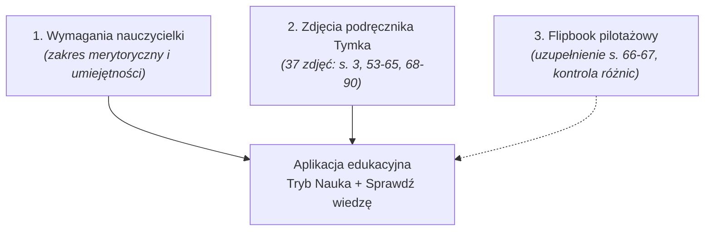
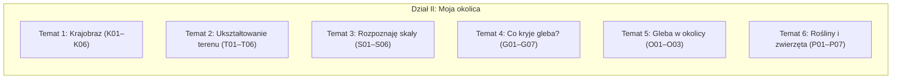
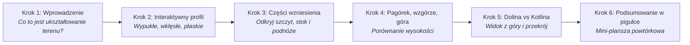
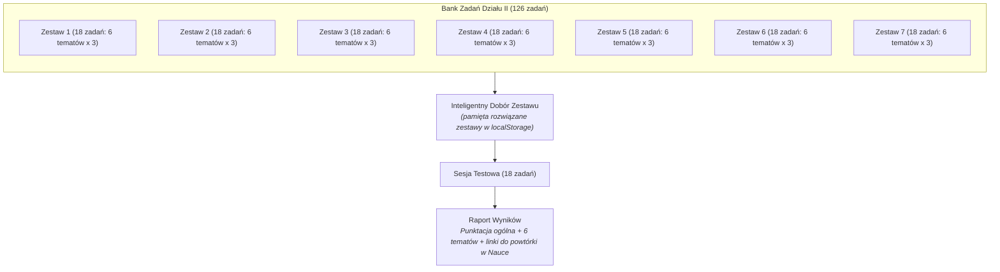
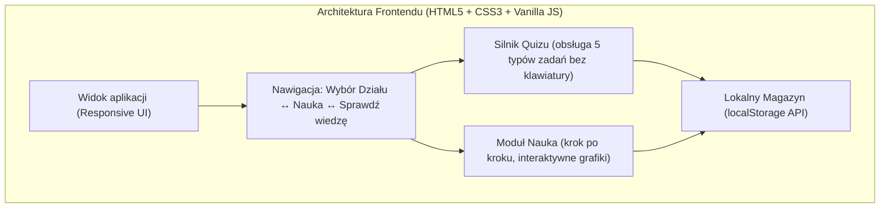

# Misja: Moja Okolica — Mapa Treści i Architektura Aplikacji
*Podręcznik Nowa Era „Odkrywam przyrodę 4” — Dział II (s. 53–90)*  
*Dla: Uczniowie klasy 4 (wiek ok. 10 lat) | Data: 17 listopada 2026*

---

## 1. Status Źródeł i Weryfikacji Materiałów

Zgodnie z ustaloną hierarchią źródeł:
1. **Wymagania nauczycielki** — wyznaczają twardy zakres sprawdzianu.
2. **Zdjęcia fizycznego podręcznika Tymka** — rozstrzygają ostateczną terminologię i układ.
3. **Oficjalny flipbook Nowej Ery (wydanie pilot 2026)** — źródło pomocnicze.

### Zestawienie i weryfikacja stron

| Strony w książce | Status materiałów | Źródło i uwagi weryfikacyjne |
|---|---|---|
| **s. 3** | Zweryfikowane | Zdjęcie `36.jpg` (spis treści działu II). |
| **s. 53** | Zweryfikowane | Zdjęcie `35.jpg` (rozkładówka otwierająca Dział II). |
| **s. 54–58** | Zweryfikowane | Zdjęcia `34.jpg`–`30.jpg` (Temat 1: Krajobraz). |
| **s. 59–63** | Zweryfikowane | Zdjęcia `29.jpg`–`25.jpg` (Temat 2: Ukształtowanie terenu). **Uwaga terminologiczna:** w książce „ukształtowanie terenu”, we flipbooku „kształt terenu” — stosujemy wersję książkową. |
| **s. 64–65** | Zweryfikowane | Zdjęcia `24.jpg`, `23.jpg` (Temat 3: Rozpoznaję skały - definicja, właściwości, skały luźne i zwięzłe). Książka definiuje skałę jako „naturalny materiał budujący powierzchnię Ziemi”. |
| **s. 66–67** | **Zweryfikowane w 100% z fizycznej książki** | Zdjęcia `nowa-1.jpg` (s. 66) oraz `nowa-0.jpg` (s. 67). **Pełny tekst i zdjęcia odczytane:** skały lite (węgiel, piaskowiec, wapień, granit) z 4 cechami (barwa, spójność/spoistość, twardość, odporność na wodę); reakcja wapienia z octem (pienienie); karta obserwacji i reguła, że beton/pustaki nie są skałami. |
| **s. 68** | Zweryfikowane | Zdjęcie `22.jpg` (zastosowanie skał w budownictwie, przemyśle i życiu codziennym). |
| **s. 69–72** | Zweryfikowane | Zdjęcia `21.jpg`–`18.jpg` (Temat 4: Co kryje gleba?). Książka precyzuje: gleba to warstwa „na powierzchni Ziemi”. Profil glebowy, składniki, próchnica. |
| **s. 73–78** | Zweryfikowane | Zdjęcia `17.jpg`–`12.jpg` (Temat 5: Gleba w mojej okolicy). Porównanie z ziemią ogrodową, doświadczenie ze wzrostem rzeżuchy/fasoli, pęcherzyki powietrza w wodzie. |
| **s. 79–84** | Zweryfikowane | Zdjęcia `11.jpg`–`6.jpg` (Temat 6: Rośliny i zwierzęta). Karty gatunkowe, korzyści z hodowli i upraw, zwierzęta w miastach i domach. |
| **s. 85–87** | Zweryfikowane | Zdjęcia `5.jpg`–`3.jpg` (Podsumowanie działu II). |
| **s. 88–90** | Zweryfikowane | Zdjęcia `2.jpg`–`0.jpg` (Zadania sprawdzające „Sprawdź, czy potrafisz”). |

> [!NOTE]
> Wszystkie 37 zdjęć z Dysku Google zostało zindeksowanych w [DZIAL-II-ZRODLA.csv](file:///C:/Users/mlata/.gemini/antigravity/scratch/nauka-przyroda-tymek/DZIAL-II-ZRODLA.csv). Treść brakujących stron 66–67 została pozyskana z flipbooka pilotażowego i włączona do matrycy.

---

## 2. Pełna Matryca Wymagań Działu II

Poniższa tabela stanowi fundament merytoryczny: każde zadanie w banku pytań oraz każdy ekran w trybie Nauka odwołuje się bezpośrednio do konkretnego identyfikatora (`K01`–`P07`). Żadne zadanie nie wymaga pisania tekstu na klawiaturze.

### A. Krajobraz mojej okolicy (s. 54–58)

| ID | Wymaganie nauczycielki | Źródło (s.) | Treść do trybu „Nauka” | Sposób sprawdzenia w „Sprawdź wiedzę” (bez pisania) |
|---|---|---|---|---|
| **K01** | Wyjaśnia pojęcie krajobrazu i różnicę względem przyrody | 54, 58, 85 | Krajobraz to widok na dany obszar Ziemi. Obejmuje zarówno przyrodę (ożywioną i nieożywioną), jak i wszystkie obiekty wzniesione przez człowieka. | **Układanie definicji** z gotowych klocków słownych; **Wybór wielokrotny**: wskaż, dlaczego asfaltowa szosa lub most należą do krajobrazu, mimo że nie są przyrodą. |
| **K02** | Wymienia i rozpoznaje elementy ożywione, nieożywione i antropogeniczne | 54, 85 | Trzy koszyki elementów: przyroda ożywiona (drzewa, ptaki, grzyby), przyroda nieożywiona (woda, skały, piasek, powietrze), wytwory człowieka (domy, drogi, latarnie). | **Sortowanie na 3 pola**: przydzielenie 6 obiektów do właściwych kategorii; **Wskazywanie na fotografii**: kliknij element wytworzony przez człowieka. |
| **K03** | Rozróżnia krajobraz naturalny i przekształcony (stworzony przez człowieka) | 55 | Krajobraz naturalny powstał bez ingerencji człowieka (np. dziewicza puszcza, wysokie góry). Przekształcony nosi wyraźne ślady działalności ludzkiej (pola, budynki, drogi). | **Porównanie dwóch zdjęć**: wybierz krajobraz naturalny i wskaż jeden kluczowy dowód (np. brak widocznych dróg i wycinek). |
| **K04** | Rozpoznaje miasto i wieś, wymienia elementy i porównuje | 56–58 | Zestawienie cech: miasto (gęsta wysoka zabudowa, dużo asfaltu, fabryki, parki) vs wieś (pola, sady, luźna niska zabudowa, zagrody, zwierzęta gospodarskie). | **Dopasowanie cech do kolumn** „Miasto” / „Wieś”; **Wskazanie różnicy** na fotografiach obu krajobrazów. |
| **K05** | Opisuje krajobraz okolicy według planu | 54, 58 | Schemat opisu: 1. Ukształtowanie terenu → 2. Wody i lasy (przyroda) → 3. Zabudowa i drogi (działalność człowieka). | **Porządkowanie kafelków opisu** w logicznej kolejności; wybór zdań najlepiej pasujących do pokazanej panoramy. |
| **K06** | Przedstawia zależności między elementami krajobrazu | 58 | Przykłady zależności: rzeka daje wodę i ryby → ludzie zakładają nad nią osadę; las zatrzymuje wodę w glebie; wycięcie lasu powoduje wysychanie terenu. | **Łączenie w pary: Przyczyna → Skutek**; wybór prawdopodobnego następstwa budowy drogi ekspresowej przez las. |

---

### B. Ukształtowanie terenu w mojej okolicy (s. 59–63)

| ID | Wymaganie nauczycielki | Źródło (s.) | Treść do trybu „Nauka” | Sposób sprawdzenia w „Sprawdź wiedzę” (bez pisania) |
|---|---|---|---|---|
| **T01** | Wyjaśnia ukształtowanie terenu | 59 | Ukształtowanie terenu to wszystkie nierówności powierzchni Ziemi: wzniesienia, obniżenia oraz tereny płaskie. | **Wybór poprawnego wyjaśnienia** spośród 4 wariantów; wybór schematu przedstawiającego ukształtowanie. |
| **T02** | Klasyfikuje formy wypukłe, wklęsłe i płaskie | 59–61, 63 | Formy wypukłe: pagórek, wzgórze, góra. Formy wklęsłe: dolina, kotlina. Formy płaskie: równina. | **Sortowanie etykiet do 3 szuflad**: Formy wypukłe / wklęsłe / płaskie; dopasowanie miniatury rysunku profilu do nazwy. |
| **T03** | Rozróżnia pagórek, wzgórze i górę | 61, 63 | Wysokość mierzona od podnóża (względna): pagórek do 50 m; wzgórze od 50 do 300 m; góra powyżej 300 m. | **Dopasowanie formy do wysokości**: 35 m → pagórek; 180 m → wzgórze; 650 m → góra (wyłącznie jednoznaczne wartości, bez spornego progu 50 m). |
| **T04** | Wskazuje szczyt, stok i podnóże wzniesienia | 61 | Ilustracja wzniesienia z odkrywanymi częściami: szczyt (najwyższy punkt), stok (zbocze: łagodne lub strome), podnóże (miejsce przejścia w płaski teren). | **Hotspoty na grafice góry**: kliknij punkt oznaczający stok łagodny / szczyt / podnóże; dopasowanie nazwy części do jej definicji. |
| **T05** | Rozróżnia dolinę, kotlinę i równinę | 60 | Równina: teren płaski. Dolina: podłużne zagłębienie, którym często płynie rzeka. Kotlina: zagłębienie otoczone wzniesieniami ze wszystkich stron. | **Wybór schematu/widoku z góry** odpowiadającego dolinie (podłużna) vs kotlinie (misowata); dopasowanie formy do opisu krajobrazu. |
| **T06** | Rozpoznaje i opisuje teren na przykładzie trasy wycieczki | 60–63, 89 | Przekrój trasy turystycznej: wspinaczka pod górę, przejście przez płaską równinę, zejście do doliny rzeki. Wpływ na osadnictwo. | **Układanie profilu trasy**: uporządkuj etapy wędrówki w kolejności; wskaż najłatwiejszy odcinek na poprowadzenie linii kolejowej. |

---

### C. Rozpoznaję skały (s. 64–68)

| ID | Wymaganie nauczycielki | Źródło (s.) | Treść do trybu „Nauka” | Sposób sprawdzenia w „Sprawdź wiedzę” (bez pisania) |
|---|---|---|---|---|
| **S01** | Wyjaśnia pojęcie skały i jej budowę z minerałów | 64, 68 | Skała to naturalny materiał budujący skorupę Ziemi. Składa się z minerałów (jednego rodzaju lub wielu połączonych ze sobą drobnych ziaren). | **Układanie zależności**: Minerały → budują → Skałę; Wybór prawidłowego zdania wyjaśniającego naturę skały. |
| **S02** | Rozpoznaje cztery badane właściwości skał | 64, 67 | 1. Barwa (kolor). 2. Spójność (lite, zwięzłe, luźne). 3. Twardość (czy daje się zarysować paznokciem / gwoździem). 4. Odporność na wodę i kwas (czy mięknie, rozmywa się lub pieni). | **Dopasowanie próby badawczej do badanej cechy**: zarysowanie gwoździem → twardość; próba rozkruszenia w dłoni → spójność; polanie wodą → odporność na wodę. |
| **S03** | Dzieli skały ze względu na spójność: lite, zwięzłe, luźne | 65, 68, 86 | **Luźne:** ziarna niepołączone (piasek). **Zwięzłe:** połączone słabo, dają się rozkruszyć, miękną z wodą (glina, less). **Lite:** mocno zespolone, twarde, nie miękną w wodzie (granit, wapień, węgiel). | **Klasyfikacja 6 skał do 3 kategorii spójności** (przeciąganie/klikanie kafelków); zadania odwrócone: wskaż skałę litą spośród 4 próbek. |
| **S04** | Opisuje właściwości piasku, gliny i lessu | 65 | Piasek: ziarnisty, sypki, przepuszcza wodę. Glina: lepka i plastyczna po zmoczeniu, zatrzymuje wodę. Less: drobny pył, żółtawy, zwięzły, łatwo eroduje. | **Wybór skały po zestawie cech laboratoryjnych** (np. „Po dodaniu wody staje się plastyczna i można z niej lepić naczynia” → Glina). |
| **S05** | Zna właściwości granitu, wapienia i węgla kamiennego | 66–67 (flipbook), 89 | Granit: wielobarwny (widoczne ziarna kwarcu, skalenia), bardzo twardy, lity. Wapień: jasny, średnio twardy, **pieni się pod wpływem octu**. Węgiel: czarny, błyszczący, kruchy, lity, pali się. | **Identyfikacja skały po teście z octem** (piana = wapień); Wskazanie granitu jako skały z wielobarwnymi, widocznymi ziarnami minerałów. |
| **S06** | Wskazuje zastosowanie poznanych skał w życiu człowieka | 68 | Granit → krawężniki, blaty, schody (twardość i odporność). Wapień → kreda, zaprawy, cement. Piasek → produkcja szkła, beton. Glina → cegły, ceramika. Węgiel → opał, ciepło. | **Łączenie par: Surowiec skalny → Produkt/Zastosowanie** (np. piasek → szklanka; glina → cegła na budowie; granit → krawężnik drogowy). |

---

### D. Co kryje gleba? (s. 69–72)

| ID | Wymaganie nauczycielki | Źródło (s.) | Treść do trybu „Nauka” | Sposób sprawdzenia w „Sprawdź wiedzę” (bez pisania) |
|---|---|---|---|---|
| **G01** | Wyjaśnia pojęcie gleby | 69, 72 | Gleba to cienka wierzchnia warstwa na powierzchni Ziemi, która zapewnia roślinom wodę, powietrze i sole mineralne, umożliwiając im wzrost. | **Wybór definicji gleby** spośród dystraktorów; odróżnienie gleby od litej skały i czystego piasku. |
| **G02** | Wymienia i omawia etapy powstawania gleby | 69 | 1. Wietrzenie litych skał (pękanie i kruszenie). 2. Pojawienie się pierwszych organizmów (mchy, porosty). 3. Gromadzenie szczątków i powstanie próchnicy. 4. Wykształcenie dojrzałego profilu glebowego. | **Układanie 4 etapów powstawania gleby w kolejności chronologicznej** (przesuwanie numerów 1–4); wskazanie zjawiska rozpoczynającego proces. |
| **G03** | Wymienia składniki gleby i dzieli je na ożywione i nieożywione | 70, 72, 86 | **Ożywione:** korzenie, dżdżownice, bakterie, larwy owadów, grzyby. **Nieożywione:** ziarna piasku, cząstki gliny, woda, powietrze oraz **próchnica** (szczątki organiczne, ale substancja nieożywiona!). | **Sortowanie składników do dwóch kolumn**: Ożywione / Nieożywione; Uwaga na pułapkę: próchnica to składnik nieożywiony. |
| **G04** | Wyjaśnia, czym jest próchnica i jaka jest rola organizmów glebowych | 69–71 | Próchnica powstaje z obumarłych szczątków roślin i zwierząt przetworzonych przez dżdżownice, bakterie i grzyby. Decyduje o ciemnej barwie i żyzności gleby. | **Połączenie w łańcuch**: Obumarłe liście → Dżdżownice i bakterie rozkładają → Powstaje żyzna próchnica. |
| **G05** | Wskazuje poziom próchniczny na profilu glebowym | 71 | Profil glebowy: wierzchnia warstwa organiczna / poziom próchniczny (ciemny, najbogatszy w próchnicę) → warstwa przejściowa (jaśniejsza) → skała macierzysta (podłoże). | **Kliknięcie hotspotu na ilustracji profilu glebowego**: wskaż warstwę próchniczną odpowiedzialną za żyzność gleby. |
| **G06** | Porównuje żyzność gleb i czynniki o niej decydujące | 71, 74, 87 | Żyzność to zdolność gleby do zaspokajania potrzeb roślin. Zależy od grubości poziomu próchnicznego i struktury gruzełkowej (gleba ciemna, gruzełkowa = żyzna; jasna, sypka = uboga). | **Porównanie dwóch próbek gleby (A i B)**: wskaż, w której roślina wyda lepsze plony i wybierz uzasadnienie (ciemny kolor, wysoka zawartość próchnicy). |
| **G07** | Przedstawia znaczenie gleby dla przyrody i człowieka | 72 | Daje pokarm (uprawa roślin), jest domem dla zwierząt glebowych, filtruje i magazynuje wodę deszczową, zatrzymuje węgiel. | **Wybór wielokrotny**: zaznacz 3 najważniejsze role gleby w przyrodzie; Połącz zagrożenie z jego skutkiem (brak gleby → brak roślin). |

---

### E. Gleba w mojej okolicy (s. 73–78)

| ID | Wymaganie nauczycielki | Źródło (s.) | Treść do trybu „Nauka” | Sposób sprawdzenia w „Sprawdź wiedzę” (bez pisania) |
|---|---|---|---|---|
| **O01** | Porównuje glebę z okolicy z gotową ziemią ogrodową | 74–76 | Ziemia ogrodowa: bardzo ciemna, duża zawartość próchnicy, puszysta. Gleba z okolicy może być piaszczysta (jasna, sucha) lub gliniasta (zbita, lepka), rzadziej bogata w próchnicę. | **Dopasowanie wyników obserwacji do próbek**: która próbka zatrzymała więcej wody, która zawierała widoczne dżdżownice. |
| **O02** | Rozumie zasady doświadczenia ze wzrostem roślin | 76 | W doświadczeniu zmieniamy **tylko jeden czynnik** (rodzaj gleby). Ilość wody, światła i temperatura w obu doniczkach muszą być identyczne! | **Wskazanie błędu badacza** w opisie doświadczenia (np. „podlewał doniczkę A dwa razy częściej niż doniczkę B”); dobór poprawnego wniosku z wykresu wzrostu. |
| **O03** | Wyjaśnia znaczenie obecności wody i powietrza w glebie | 72, 77–78 | Doświadczenie z wrzuceniem grudki gleby do wody: lecące pęcherzyki dowodzą obecności powietrza. Powietrze jest niezbędne do oddychania korzeni i zwierząt glebowych. | **Interpretacja rysunku z menzurką i pęcherzykami**: wybierz wniosek potwierdzony tą obserwacją; wskaż skutek całkowitego zalania gleby wodą (brak powietrza dla korzeni). |

---

### F. Rośliny i zwierzęta w mojej okolicy (s. 79–84)

| ID | Wymaganie nauczycielki | Źródło (s.) | Treść do trybu „Nauka” | Sposób sprawdzenia w „Sprawdź wiedzę” (bez pisania) |
|---|---|---|---|---|
| **P01** | Wymienia korzyści z przyrody i uprawy roślin | 79, 87 | Tlen, owoce i warzywa (żywność), drewno na meble i papier, len i bawełna na ubrania, zioła lecznicze, odpoczynek i piękny widok. | **Dopasowanie korzyści do kategorii**: Żywność / Materiały / Zdrowie i wypoczynek; wybór surowca roślinnego dla danego przedmiotu. |
| **P02** | Wymienia korzyści z hodowli zwierząt i zasady opieki | 80–81 | Zwierzęta gospodarskie: mleko, jaja, wełna, miód. Zwierzęta domowe: przyjaźń, ruch, nauka odpowiedzialności (karmienie, spacery, weterynarz). | **Klasyfikacja korzyści**: Zwierzę gospodarskie → produkt (np. krowa → mleko, pszczoła → miód); Wybór właściwego zachowania opiekuna psa. |
| **P03** | Rozpoznaje 6 lokalnych roślin po cechach morfologicznych | 82, 90 | Karty rozpoznawania: Lipa drobnolistna, Brzoza brodawkowata, Śnieguliczka biała, Róża dzika, Koniczyna biała, Babka lancetowata. | **Identyfikacja fotografii / zbliżenia liścia i owocu**: wskaż nazwę rośliny; dopasuj cechę charakterystyczną (np. sercowate liście → lipa). |
| **P04** | Rozpoznaje 6 lokalnych ptaków po wyglądzie i cechach | 83 | Karty rozpoznawania: Gawron, Kawka, Sroka, Szpak, Kos (samiec), Wrona siwa. Sylwetki, dzioby, ubarwienie. | **Dopasowanie fotografii do nazwy ptaka**; wskaż ptaka o czarno-białym ubarwieniu i długim ogonie (sroka); wskaż kawkę po jasnym oku i szarej szyi. |
| **P05** | Rozpoznaje lokalne owady i ich cechy charakterystyczne | 84 | Karty owadów: Skorek pospolity (szczypawka), Biedronka siedmiokropka, Rusałka pokrzywnik. Dodatkowo: biedronka azjatycka w zadaniu. | **Rozpoznanie owada na zdjęciu**; wskaż funkcję cęgów skorka; policz kropki biedronki siedmiokropki (dokładnie 7, po 3 z boku i 1 u góry). |
| **P06** | Rozpoznaje obecność zwierząt w okolicy po śladach | 70, 74, 81, 90 | Korytarze w ziemi i kopce (kret), pajęczyna (kątnik), zrzucone poroże / zgryziona kora (sarna), pióro, wypluwka, odchody, ślady żerowania. | **Dopasowanie śladu do zwierzęcia, które go pozostawiło**; ostrożne wnioskowanie: co możemy jednoznacznie stwierdzić na podstawie odnalezionego śladu. |
| **P07** | Wyjaśnia przyczyny pojawiania się dzikich zwierząt w miastach | 81 | Łatwo dostępny pokarm (otwarte śmietniki, resztki rzucane przez ludzi), cieplejszy mikroklimat zimą, brak dużych drapieżników polujących na nie. | **Wybór wielokrotny**: zaznacz 3 rzeczywiste powody, dla których lisy i dziki wchodzą do miast; wskaż, jak ludzie powinni zabezpieczać odpady. |

---

## 3. Szczegółowy Rejestr Kart Rozpoznawania

Wymagania nauczycielki kładą szczególny nacisk na **rozpoznawanie ze zdjęć**. Poniższe zestawienie stanowi twardy kanon gatunkowy do przygotowania ilustracji i zadań:

### Rośliny (s. 82)
1. **Lipa drobnolistna**: liście sercowate, u nasady asymetryczne, drobno piłkowane; skrzydełko (podsadka) przytwierdzone do szypułki owoców ułatwiające rozsiewanie przez wiatr.
2. **Brzoza brodawkowata**: biała kora łuszcząca się cienkimi płatami, ciemne spękania w dole pnia; trójkątne lub rombowate liście na wiotkich, zwisających gałązkach.
3. **Śnieguliczka biała**: krzew ozdobny w parkach i żywopłotach; charakterystyczne kuliste, śnieżnobiałe, gąbczaste owoce utrzymujące się jesienią i zimą. *(Uwaga edukacyjna: owoce niejadalne!)*.
4. **Róża dzika**: pędy z ostrymi kolcami; liście złożone z kilku mniejszych listków; owalne, ciemnoczerwone owoce pozorne bogate w witaminę C; jasnoróżowe kwiaty.
5. **Koniczyna biała**: liście trójlistkowe z charakterystycznym jasnym, łukowatym wzorkiem; kuliste białe lub kremowe główki kwiatostanów; roślina łąkowa i trawnikowa.
6. **Babka lancetowata**: liście podłużne, lancetowate z wyraźnymi równoległymi nerwami zebrane w rozetę przy ziemi; kwiatostan w formie brunatnego kłosa na szczycie długiej, sztywnej, bezlistnej łodygi.

### Ptaki (s. 83)
1. **Gawron**: cały czarny z metalicznym fioletowo-granatowym połyskiem; u dorosłych osobników jasna, naga skóra wokół nasady dużego dzioba; charakterystyczne „nogawice” z piór na nogach.
2. **Kawka**: mniejsza od wrony i gawrona; tułów ciemnoszary, boki głowy i kark wyraźnie jasnoszare; charakterystyczna biała lub jasnoniebieska tęczówka oka.
3. **Sroka**: długi schodkowaty ogon o zielonkawo-fioletowym połysku; kontrastowe czarno-białe upierzenie (biały brzuch i boki skrzydeł, czarna głowa, pierś i grzbiet).
4. **Szpak**: mniejszy od kosa; krótki ogon; ciemne upierzenie mieniące się fioletowo-zielono, gęsto nakrapiane jasnymi trójkątnymi plamkami; ostry dziób (wiosną żółty).
5. **Kos (samiec)**: jednolicie smoliście czarne upierzenie; jaskrawy, intensywnie żółty lub pomarańczowy dziób oraz żółta wąska obwódka wokół oka. *(Samica jest brunatna — w zadaniach precyzujemy, że chodzi o samca)*.
6. **Wrona siwa**: wyraźnie dwubarwna: tułów popielatoszary, natomiast głowa, gardło, skrzydła i ogon czarne.

### Owady (s. 84)
1. **Skorek pospolity (szczypawka)**: spłaszczone brunatne ciało; charakterystyczne cęgi (szczypce) na końcu odwłoka służące do obrony i składania skrzydeł; nocny tryb życia; nieszkodliwy dla człowieka.
2. **Biedronka siedmiokropka**: czerwone lub pomarańczowo-czerwone pokrywy skrzydeł z dokładnie siedmioma czarnymi kropkami (po 3 na każdej pokrywie i jedna wspólna przy tarczce); pożyteczny drapieżnik zjadający mszyce. *(Zadanie porównawcze z inwazyjną biedronką azjatycką arlekinem)*.
3. **Rusałka pokrzywnik**: dzienny motyl o ceglastoczerwonych skrzydłach z żółtymi i czarnymi plamami przy przedniej krawędzi oraz rzędem błękitnych plamek w czarnej obwódce na brzegu skrzydeł; gąsienice żerują gromadnie na pokrzywach.

### Zwierzęta synantropijne i ślady (s. 70, 74, 81, 90)
- **Kątnik domowy**: duży pająk tworzący lejkowate sieci w ciemnych zakamarkach, piwnicach i za meblami.
- **Rybik cukrowy**: mały, srebrzysty, bezskrzydły owad biegający w wilgotnych miejscach (łazienki). *(W książce s. 81 przedstawiony jako nieszkodliwy lokator, choć podpis wspomina o kleju i papierze — unikamy spornych pytań)*.
- **Ślady obecności**: kopce kreta, korytarze dżdżownic w profilu gleby, zgryziona kora na pniach drzew (sarny/zające), odchody, pióra i wypluwki ptaków.

---

## 4. Projekt Przebiegu Modelowego Tematu Nauki
*(Przykład: Temat 2 — Ukształtowanie terenu w mojej okolicy, s. 59–63)*

Tryb **Nauka** podzielony jest na logiczne, krótkie „kroki” (slajdy interaktywne). Dziecko nie jest odpytywane ze zgadywania — najpierw poznaje zjawisko, klika i bada elementy, a na koniec ma krótkie utrwalenie.

### Scenariusz kroków tematu:

1. **Krok 1: Co to jest ukształtowanie terenu? (s. 59)**
   - *Tekst:* „Powierzchnia Ziemi nie jest wszędzie taka sama. Jedne miejsca są płaskie jak stół, inne wznoszą się wysoko, a jeszcze inne tworzą głębokie obniżenia. Wszystkie te nierówności nazywamy **ukształtowaniem terenu**.”
   - *Interakcja:* Suwak lub przycisk „Zmień perspektywę” — ilustracja krajobrazu z falami terenu.

2. **Krok 2: Trzy główne rodzaje form terenu (s. 59–60)**
   - *Grafika:* Przekrój poziomy z trzema strefami.
   - *Interakcja:* Kliknięcie na jeden z trzech kafelków podświetla odpowiedni fragment rysunku:
     - 🟢 **Formy wypukłe** (wzniesienia ponad otaczający teren)
     - 🔵 **Formy wklęsłe** (obniżenia poniżej otoczenia)
     - 🟡 **Formy płaskie** (równiny bez wyraźnych wzniesień i zagłębień)

3. **Krok 3: Części wzniesienia — zbadaj górę (s. 61)**
   - *Grafika:* Czytelny schemat góry/pagórka z trzema punktami aktywnymi (hotspotami).
   - *Interakcja:* Kliknięcie pulsującego punktu odkrywa etykietę i dymek z prostym wyjaśnieniem:
     - 🏔️ **Szczyt** — najwyżej położone miejsce wzniesienia.
     - 📐 **Stok** — nachylona powierzchnia między podnóżem a szczytem. Może być łagodny (łatwo wejść) lub stromy (trudno wejść).
     - 🥾 **Podnóże** — miejsce na dole, gdzie wzniesienie zaczyna się podnosić z płaskiego terenu.

4. **Krok 4: Jak odróżnić pagórek, wzgórze i górę? (s. 61)**
   - *Zasada:* Mierzymy wysokość względną — od podnóża do szczytu!
   - *Interaktywna miarka:*
     - Pagórek: do 50 metrów (jak 15-piętrowy blok).
     - Wzgórze: od 50 do 300 metrów (jak wieża Eiffla).
     - Góra: powyżej 300 metrów (ogromne wzniesienia, w Polsce np. Tatry, Karkonosze).
   - *Dźwignia wysokości:* Przesunięcie suwaka od 0 do 800 m zmienia rysunek wzniesienia i podświetla właściwą nazwę.

5. **Krok 5: Dolina a Kotlina — formy wklęsłe (s. 60)**
   - *Porównanie:* Dwa okienka obok siebie:
     - **Dolina:** podłużne obniżenie, ma dno i zbocza, na dnie bardzo często płynie rzeka lub strumień.
     - **Kotlina:** rozległe obniżenie otoczone ze wszystkich stron wzniesieniami (jak wielka misa).
   - *Przełącznik:* „Widok z góry” / „Przekrój z boku”.

6. **Krok 6: Podsumowanie i karta pamięci (s. 63)**
   - Zestawienie 5 kluczowych pojęć w formie zwięzłych kafelków. Przycisk „Wracam do spisu tematów” lub „Sprawdź wiedzę z tego działu”.

---

## 5. Architektura Banku Zadań i Trybu „Sprawdź Wiedzę”

Aby dziecko mogło podchodzić do testu **3–7 razy bez nudnego powtarzania tych samych pytań**, aplikacja operuje na stałym, zweryfikowanym **banku co najmniej 126 zadań** podzielonym na **7 równorzędnych zestawów** po 18 zadań (po 3 zadania z każdego z 6 tematów).

### Struktura pojedynczego testu (18 zadań):
W każdym teście występuje zbalansowany przekrój typów zadań:
- **Temat 1: Krajobraz** (3 zadania: 1 definicyjne, 1 klasyfikacja/zdjęcie, 1 zależność)
- **Temat 2: Ukształtowanie terenu** (3 zadania: 1 formy wypukłe/wklęsłe, 1 części góry/hotspot, 1 wysokości/trasa)
- **Temat 3: Rozpoznaję skały** (3 zadania: 1 właściwości/spójność, 1 rozpoznanie skały, 1 zastosowanie)
- **Temat 4: Co kryje gleba?** (3 zadania: 1 etapy powstawania/profil, 1 składniki żywe/martwe, 1 żyzność/znaczenie)
- **Temat 5: Gleba w okolicy** (3 zadania: 1 cechy próbki, 1 doświadczenie ze wzrostem, 1 woda i powietrze)
- **Temat 6: Rośliny i zwierzęta** (3 zadania: 1 rozpoznanie rośliny, 1 rozpoznanie ptaka/owada, 1 ślady/przyczyny zwierząt w miastach)

### Standard różnicowania wariantów (dlaczego to nie jest zwykłe tasowanie odpowiedzi):
- **Wariant A:** Zadanie rozpoznawcze na podstawie zdjęcia liścia → wybór gatunku drzewa.
- **Wariant B:** Zadanie odwrócone: podana nazwa drzewa → wybór zdjęcia jego owocostanu spośród 3 propozycji.
- **Wariant C:** Porównanie dwóch drzew (np. kora brzozy vs liść lipy) w kontekście spaceru po parku.
- **Wariant D:** Dopasowanie opisu cechy morfologicznej do właściwego gatunku w formie łączenia par.

### Typy interakcji (100% bez pisania z klawiatury):
1. **Wybór jednej lub wielu kart** (`choice` / `multichoice` z dokładną oceną kompletu).
2. **Sortowanie do koszyków / szuflad** (`bin_sort`: kliknij element → kliknij koszyk docelowy, z alternatywą drag-and-drop).
3. **Wskazywanie na ilustracji / profilu** (`hotspot`: kliknij szczyt, wskaż warstwę próchniczną).
4. **Łączenie par** (`match`: skała → zastosowanie; przyczyna → skutek).
5. **Układanie sekwencji chronologicznej** (`order`: etapy powstawania gleby, etapy wycieczki).

---

## 6. Przykładowe Zadania z Banku (Demonstracja Mechaniki)

### Zadanie 1: Klasyfikacja skał ze względu na spójność (ID: S03-Z1)
- **Typ:** Sortowanie kafelków do 3 kolumn (`bin_sort`).
- **Polecenie:** „Podziel podane skały według ich spójności. Kliknij skałę, a następnie wybierz odpowiednią grupę.”
- **Elementy do posortowania:** Piasek, Glina, Less, Granit, Wapień, Węgiel kamienny.
- **Kategorie:**
  - *Skały luźne* → Piasek
  - *Skały zwięzłe* → Glina, Less
  - *Skały lite* → Granit, Wapień, Węgiel kamienny
- **Punktacja:** 1 pkt za bezbłędne przyporządkowanie (0.5 pkt przy jednym błędzie).
- **Wyjaśnienie po odpowiedzi:** „Skały luźne (piasek) nie mają połączonych ziaren. Zwięzłe (glina, less) kruszą się w dłoniach i miękną z wodą. Skały lite (granit, wapień, węgiel) są silnie zespolone i twarde.”

### Zadanie 2: Identyfikacja na profilu glebowym (ID: G05-Z1)
- **Typ:** Wskazanie na grafice (`hotspot`).
- **Polecenie:** „Rolnik chce sprawdzić, czy jego pole ma grubą warstwę dającą roślinom najwięcej składników odżywczych. Kliknij na rysunku profilu glebowego **poziom próchniczny**.”
- **Grafika:** Przekrój gleby z 4 warstwami: ściółka (A), poziom próchniczny ciemny (B), warstwa przejściowa jasna (C), lita skała podłoża (D).
- **Poprawny punkt:** Warstwa B.
- **Wyjaśnienie:** „Poziom próchniczny to ciemna warstwa tuż pod powierzchnią. Zawiera próchnicę powstałą z rozłożonych szczątków, która decyduje o żyzności gleby.”

### Zadanie 3: Rozpoznawanie ptaków po cechach (ID: P04-Z1)
- **Typ:** Wybór na podstawie fotografii (`choice`).
- **Polecenie:** „Podczas spaceru po osiedlu zauważyłeś ptaka wielkości gołębia. Miał popielatoszary tułów, natomiast jego głowa, gardło, skrzydła i ogon były całkowicie czarne. Który to ptak?”
- **Opcje ze zdjęciami:**
  - A: Gawron *(cały czarny z jasną nasadą dzioba)*
  - B: Sroka *(czarno-biała z bardzo długim ogonem)*
  - C: Wrona siwa *(poprawna: dwubarwna)*
  - D: Kawka *(ciemnoszara z jasnym okiem i szarym karkiem)*
- **Poprawna:** C.
- **Wyjaśnienie:** „Wrona siwa ma charakterystyczne dwubarwne upierzenie: popielaty tułów i kontrastującą czarną głowę, skrzydła oraz ogon.”

### Zadanie 4: Zależności przyczynowo-skutkowe (ID: K06-Z1)
- **Typ:** Łączenie par (`match`).
- **Polecenie:** „Połącz przyczynę z bezpośrednim skutkiem w krajobrazie.”
- **Pary:**
  - *Rzeka przepływa przez równinę* ➔ *Ludzie budują przystań i osadę rybacką*
  - *Wycięcie lasu na wzgórzu* ➔ *Deszcz łatwiej wypłukuje i niszczy glebę*
  - *Odkrycie bogatych złóż węgla* ➔ *Powstanie kopalni, hałd i osiedli górniczych*
- **Wyjaśnienie:** „Każda działalność człowieka i każdy element przyrody wpływają na pozostałe składniki krajobrazu.”

---

## 7. Architektura Techniczna Aplikacji

Aplikacja zostanie zrealizowana w nowoczesnym, zoptymalizowanym standardzie webowym, w pełni kompatybilnym z urządzeniami mobilnymi (smartfon, tablet) i komputerem:

### Główne filary techniczne:
1. **Zero zależności zewnętrznych (Offline-First):**
   - Kod aplikacji działa w 100% lokalnie w przeglądarce.
   - Brak zewnętrznych bibliotek npm i skryptów z CDN — bezpieczeństwo, szybkość ładowania w ułamku sekundy, brak ryzyka zablokowania przez sieć szkolną czy brak internetu.
2. **Pełna responsywność (Mobile & Touch First):**
   - Elastyczny interfejs dostosowany do ekranów dotykowych smartfonów (duże kafelki min. 48px, obsługa tapnięć bez konieczności precyzyjnego przeciągania palcem).
   - Ergonomiczny układ na komputerze stacjonarnym i laptopie.
3. **Persystencja danych (Postęp ucznia):**
   - Wykorzystanie `window.localStorage` do zapisu:
     - ukończonych ekranów w trybie Nauka,
     - historii podejść do testów (daty, wyniki procentowe, punkty cząstkowe wg tematów),
     - rejestru wylosowanych zestawów zadań, co gwarantuje, że kolejne podejścia przynoszą nowe pytania.
4. **Modułowa architektura pod całą książkę:**
   - Ekran wyboru działów z czytelnym oznaczeniem:
     - **Dział I:** Gotowy (możliwość zintegrowania zaktualizowanego materiału),
     - **Dział II („Moja okolica”):** Pełny moduł z trybem Nauka i Sprawdź wiedzę,
     - **Działy III–VI:** Oznaczone jako *„W przygotowaniu”* (zablokowane, bez pozorowania gotowości).

---

## 8. Zestawienie Decyzji Otwartych do Potwierdzenia z Rodzicem

Wszystkie ustalenia bazowe (brak pisania, dwa tryby, brak przymusowego trybu ćwiczeń, pierwszeństwo książki nad flipbookiem) zostały wdrożone. Do ostatecznego zatwierdzenia przed kodowaniem aplikacji pozostają:

1. **Termin sprawdzianu Tymka:**
   - Kiedy dokładnie odbędzie się sprawdzian w szkole? Pozwoli to ustalić priorytet testowania i wdrożenia.
2. **Brakujące zdjęcia stron 66–67:**
   - Mamy pełną treść s. 66–67 z flipbooka. Czy rodzic może dosłać zdjęcie tych dwóch stron z fizycznej książki Tymka w celu weryfikacji 100% zgodności słownictwa?
3. **Elementy grywalizacji i motywacji:**
   - Zgodnie z ustaleniami nie przenosimy automatycznie 3 żyć ze starej gry (aby nie stresować dziecka zablokowaniem podejścia).
   - Proponujemy: gwiazdki / odznaki za ukończenie tematów, pasek postępu, wesołe podsumowanie po teście z konkretnymi wskazówkami, co powtórzyć w Nauce. Czy taki model odpowiada rodzicowi?
4. **Sposób uruchamiania:**
   - Czy aplikacja ma być przygotowana jako pojedynczy, wygodny plik `.html` (jak dotychczasowa gra, otwierana jednym kliknięciem na telefonie i komputerze), czy wystawiona na prywatnym hostingu (np. GitHub Pages)?
